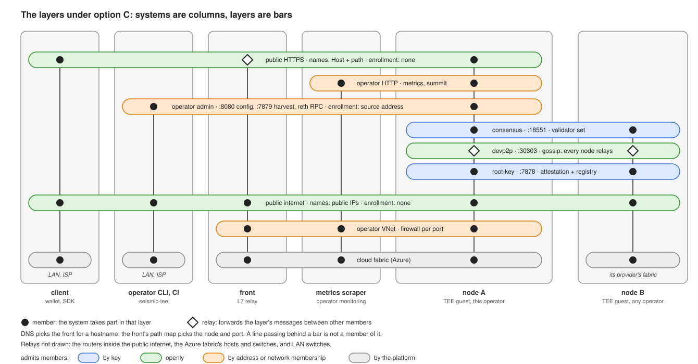

# Public proxy placement (decision record)

> **Decision record — October 2026.** A point-in-time capture of the options
> pass on where the node's public HTTPS proxy runs. It is not updated as the
> design moves; the current-state docs it links are the authority on what runs
> today.

**Outcome: open,** in
[SEI-888](https://linear.app/seismic-systems/issue/SEI-888). The question
came up while replacing nginx and certbot with an unprivileged Caddy in the
image
([seismic-images #81](https://github.com/SeismicSystems/seismic-images/pull/81),
SEI-629 under SEI-843).

## The question

An operator running more than one node needs a front outside the image anyway.
A staking operator may run a validator plus up to `observers_per_validator`
read-only nodes, and wants one hostname over all of them. An in-image proxy
cannot serve that hostname on its own:

- TLS-ALPN-01 fails behind a TLS-terminating load balancer, since the load
  balancer answers the handshake.
- Behind a TCP passthrough load balancer, the challenge lands on a random
  backend.
- DNS-01 would put DNS credentials inside the TEE.

So the question is not "proxy inside or outside the CVM", but **whether the
image also needs a proxy of its own, given a front outside it**. Behind a
front, an in-image proxy only routes: plain HTTP, or a certificate the image
makes for itself for the hop from the front. It never takes a public
certificate.

## Options

- **A. In-image proxy only** (today's node, since seismic-images #81). Fits
  single-node operators only.
- **B. External front plus an in-image router.** The router has no ACME and no
  domain config. It keeps the backends on loopback and enforces the exact
  routes. The front terminates public TLS.
- **C. External front only.** The image runs no proxy, and the backends bind a
  non-loopback address.

Each column is a system and each bar a layer: a scope with its own names and
its own rule for who may take part. Against today's node, option C changes
three layers:

- **Public HTTPS** spans the client, the front and the node, not the client and
  the node. DNS picks the front, and the front's path map picks the node and
  port. What is reachable is the front's path map plus each backend listener's
  methods, so the policy lives with the operator, not in the image.
- **Operator HTTP** is new: metrics and summit's full query set, each on its
  own listener, reached from inside the operator's VNet. Today they share
  `:443` with public RPC. The summit queries clients need stay on public
  HTTPS, on a listener of their own behind the front: the light client's
  finalized headers and state proofs ([Key records & light clients](https://linear.app/seismic-systems/project/key-records-and-light-clients-9a17291b5b1c)), and
  what the staking UI reads.
- **Operator VNet** is new: one operator's private network, joined by being in
  their Azure subscription, with firewall rules per port and source set by
  deploy.

## What TLS on the public port protects

- **Not shielded data.** Confidentiality comes from attested
  application-layer keys ([architecture.md](../architecture.md)). The manifest
  pins `tx_io_pk@0`. Later epochs' keys are to be recorded in summit's
  consensus state and checked by clients with a light client
  ([the root-key commitment record](2026-09-root-key-commitment.md),
  [Key records & light clients](https://linear.app/seismic-systems/project/key-records-and-light-clients-9a17291b5b1c)).
- **Nothing against the operator or host.** They control DNS and routing, so
  they pass HTTP-01 and TLS-ALPN-01 for the node's name and get a valid
  certificate whenever they want.
- **Third parties on the path,** for:
  - browsers: an HTTPS page can only call `https` and `wss`;
  - the integrity of public reads;
  - the privacy of non-shielded queries, such as which addresses a client
    looks up.
- **Not needed for:** the peer planes, the `seismic-tee` CLI's operator calls
  (plain HTTP to `:7878` and `:7879`, with its own attestation checks, and to
  `:8080`, guarded by the firewall), CI smoke tests, the front to node hop,
  and metrics scrapes. The CLI's HTTPS calls, its reth reads, are among
  [a front's costs](#what-a-front-alone-gives).

## What an in-image proxy adds on top of a front

- **The measured image decides what is public.** Backends stay on loopback,
  and only the exact routes are reachable. Without it (C), a firewall rule in
  deploy decides, outside the measurement.
- **A single-node operator needs no front** (A only). Under B and C, they bring
  one too.
- **No managed front reads non-shielded RPC** (A only). A host that wants to
  has to obtain a certificate for the node's name itself. It can, but the
  issuance shows up in Certificate Transparency logs.

## What it costs

- **The most exposed parser on the node runs in the guest that holds
  `root_key`,** where in-guest root can read it (A and B).
- **With ACME** (A):
  - The image carries Caddy, a pinned Go toolchain, a fourth source pin and
    the Caddyfile.
  - The config POST carries the operator's domain and email, the injection
    class SEI-776 had to close.
  - Every new hostname takes a certificate at first boot. Let's Encrypt
    allows 50 a week per registered domain, and the nightly found-devnet
    spends 28 (SEI-821, SEI-823). Past the cap, Caddy falls back to ZeroSSL,
    which publishes no per-domain or weekly limit on its free 90-day
    certificates, so the cost is a second CA to depend on rather than a
    failed founding.
- **Changing which routes are public needs a new image** and new measurements
  (A and B).

## What a front alone gives

- A smaller image: Caddy, its build, the domain config and `domain.env` all
  go.
- One hostname over many nodes. `tx_io_pk` is the same on every node, so any
  node serves shielded transactions. A hostname is both the service's name and,
  through DNS, its locator
  ([networking.md](../networking.md#four-kinds-of-name)), so serving one name
  from many nodes needs a mapping point, which is the front.
- One wildcard certificate, issued by DNS-01 from deploy, covers every devnet
  and CI name. CI can skip TLS and reach node IPs over plain HTTP from
  `operator_ip_cidr`.
- Rate limiting, WAF and DDoS protection sit in the front.
- The public/internal split becomes a firewall rule. Today `:443` serves public
  RPC and the operator's metrics routes on one port, so a firewall on ports
  cannot tell them apart. Under C, metrics and summit's full query listener
  each have their own port, never go through the front, and the firewall
  admits only the monitoring source.

Its costs:

- Every cloud target and every third-party operator brings a front. Operators
  without one get no rate limiting beyond reth's own limits.
- A managed front reads non-shielded RPC in plaintext, and the hop from the
  front to the node is plaintext inside the VNet unless the image terminates
  TLS for it.
- The CLI's reth reads move off the hostname. Today the CLI reads each node's
  reth over `https://<fqdn>/rpc`:
  - a node's `seismic_nodeInfo`, whose enode host it checks against the IP it
    appraised
    ([what is verified about an address](../networking.md#what-is-verified-about-an-address));
  - every node's block 0, in the launch assertions.

  Behind a front over many nodes, each read lands on whichever node the front
  picks. The CLI has to read them from the node's IP instead, so reth's RPC
  also listens on a port the firewall opens to the operator's range. This
  holds under B too.

## Fronts and their cost

East US list prices as of this record. Each front can serve many hostnames
and nodes, so the cost is per operator or per region, not per node. For scale,
a `DC4es_v6` confidential VM is about $147 a month.

- **Azure Application Gateway Standard_v2:** about $180 a month fixed, plus
  capacity units. WAF_v2 is about $323 a month. No built-in ACME: certificates
  go into Key Vault through a renewal job of our own.
- **Azure Front Door Standard:** about $35 a month, plus per-GB and
  per-request fees. Managed certificates. WebSockets are capped at 2 hours per
  connection, 5 minutes idle, and 3,000 concurrent per profile.
- **A small ordinary VM running Caddy or HAProxy:** about $10–30 a month. It
  sits outside the TEE, which this design allows.
- **Azure Standard Load Balancer:** about $18 a month. It passes TCP through
  and does not terminate TLS.
- **For comparison:** AWS ALB is about $16 a month and GCP's global L7 load
  balancer about $18 a month, each plus usage.

## Affected issues under C

SEI-843's children, and the issues that touch the proxy. Under B, the same
holds except that the in-image Caddy stays as a router without ACME rather
than going, and SEI-628 keeps its section for it.

- **SEI-776 (done):** `Hostname` still validates bootnode hosts. The domain
  config leaves the POST.
- **SEI-820 (done):** nothing left to fix.
- **SEI-629 (done):** shipped the in-image Caddy. Removing it, and binding
  the backends to a non-loopback address, needs an issue of its own.
- **SEI-821, SEI-823:** moot. Certificates become deploy's concern.
- **SEI-822 (done):** deploy closed `:80`, which no option needs. Under C,
  `:443` closes too.
- **SEI-304:**
  - the tier split becomes the front's path map plus firewall rules;
  - method narrowing stays in the backends, under either of SEI-304's own
    options for the attestation service;
  - per-IP rate limits move to the WAF.
- **SEI-778:** the TPM gate is still the fix, since `:7878` is open to the
  internet directly. Only its proxy rate-limit bullet moves.
- **SEI-628:** the `caddy.service` section goes.
- **SEI-588, SEI-589:** nothing to stub. The guests serve plain HTTP on their
  own IPs.

## Left open

- Whether "the measured image decides what is public" is worth an in-guest
  parser next to `root_key` (B against C).
- Whether the trust model accepts a managed front seeing non-shielded RPC in
  plaintext. If it does, [trust-model.md](../trust-model.md) says so.
- What third-party operators are told: a documented requirement to bring a
  TLS front, and maybe a reference proxy config shipped outside the image.
- Which front our own networks use.
- Whether each node keeps its own FQDN behind a front.
  [networking.md's DNS section](../networking.md#dns) assumes one A record and
  one certificate per node.
