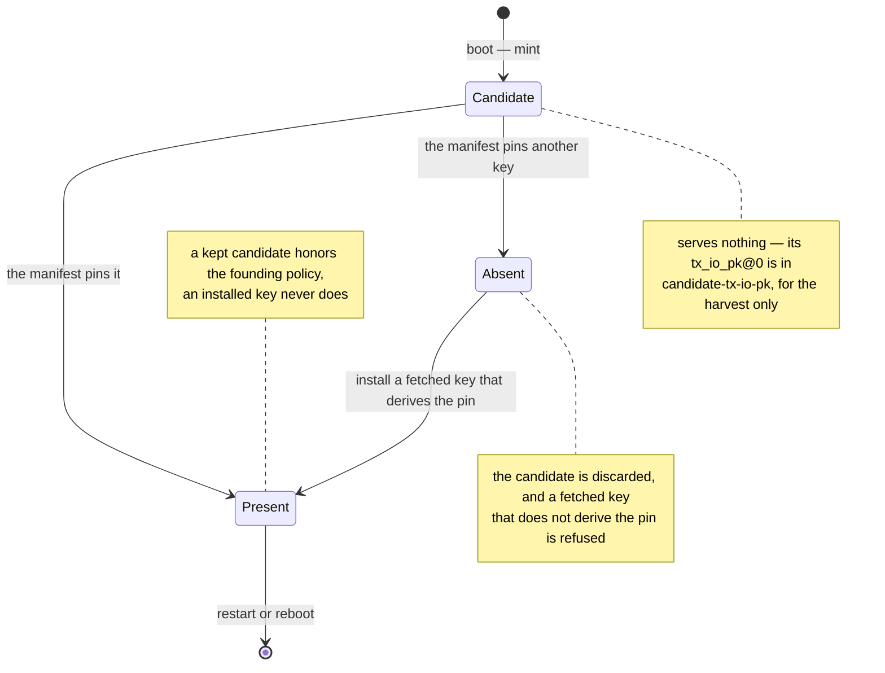

# Key Custody <!-- omit in toc -->

**Status**: shipped, except state transfer between nodes, which is designed and
not built. Recovery from a full-fleet loss, rotation of `root_key`, and whether
a joiner should require more than one responder's yes are open; each is stated
where it bites, with the current default named.

Who holds each key on a TEE node, and how the one network secret, `root_key`,
moves between the custodians that hold it. Every label, salt, and KDF belongs
to [the key schedule](../key-schedule.md), and the byte-exact transcript
bindings to [the network manifest](network-manifest.md#consumers-of-network_id).
The boundary rules at the code are the module docs of the
[`custodian`](https://github.com/SeismicSystems/enclave/blob/seismic/crates/custodian/src/lib.rs)
and
[`custodian-ipc`](https://github.com/SeismicSystems/enclave/blob/seismic/crates/custodian-ipc/src/lib.rs)
crates and the
[`custodian-service`](https://github.com/SeismicSystems/enclave/blob/seismic/bin/custodian-service/src/main.rs)
binary; this doc is the picture across the repos that implement them.

- [Summary](#summary)
- [`root_key` is membership](#root_key-is-membership)
- [The custodian](#the-custodian)
  - [An authorization in, never evidence](#an-authorization-in-never-evidence)
  - [Two layers gate the socket](#two-layers-gate-the-socket)
  - [The wire](#the-wire)
- [`root_key` at boot: candidate, present, absent](#root_key-at-boot-candidate-present-absent)
- [How a node obtains `root_key`](#how-a-node-obtains-root_key)
- [The root-key handshake](#the-root-key-handshake)
- [Per-purpose keys](#per-purpose-keys)
- [Every key on a node](#every-key-on-a-node)
- [State transfer](#state-transfer)
- [Design rationale](#design-rationale)

## Summary

- **Holding `root_key` is membership** in the network's privacy trust domain.
  A seat in the validator set is a separate gate.
- **One process holds `root_key`.** It lives in the custodian and nowhere else.
  The custodian has no network listener and no async runtime, and every other
  process asks it for one named operation over a Unix socket.
- **The custodian takes an authorization, never evidence.** It never parses a
  quote, a certificate chain, or platform collateral. Whoever decides that a
  peer may have `root_key` hands over a verified transcript binding, and the
  custodian acts on it.
- **`root_key` is never written to disk, so every boot obtains it.** One box
  keeps its own candidate, once, at founding. Every other boot, everywhere,
  fetches the key from a node that holds it, and installs it only if it derives
  the manifest's pin.
- **One attested round moves `root_key` between custodians.** Both quotes bind
  `network_id`, and every property lives in the message bodies, so the
  transport is plain HTTP: attestation binds keys, not channels.
- **Derived keys leave in plaintext, to the one user granted each.** reth holds
  the tx-io keypair and the RNG input for its process lifetime; the LUKS keys
  are handed over once per boot.
- **Per-VM keys are not the custodian's.** Summit's keys and reth's devp2p key
  are each node's own randomness, owned by the process that uses them.

## `root_key` is membership

`root_key` is 32 bytes of network-shared secret, and every long-lived node
secret except the per-VM ones is derived from it. Holding it is what makes a
machine part of the network's privacy trust domain: it can decrypt every
transaction and open every node's volume. A seat in the validator set is a
separate membership, held by the summit genesis at founding and by the deposit
path afterwards
([two gates](network-founding.md#why-founding-time-quote-verification-is-load-bearing)).
Whether either should imply the other is [the validator key custody
decision](trust-model.md#open-decisions).

**A node cannot sync its way in.** Re-executing any historical block that
carries a TxSeismic needs `tx_io_sk`, which needs `root_key`. Seismic history is
not readable from outside the trust domain, which is what makes [the root-key
handshake](#the-root-key-handshake) — not a sync protocol — the thing that
grants membership.

## The custodian

`root_key` lives in exactly one process:

```
seismic-attestation-service (user: attestation)
  · JSON-RPC on :7878, the founding harvest on :7879; holds no key material
  · connects out to /run/seismic/custodian/custodian.sock for key operations

seismic-custodian-service (user: custodian)
  · mints a candidate root_key at boot, writes its tx_io_pk@0 to
    candidate-tx-io-pk, and keeps it only if the manifest pins it
  · owns root_key in process memory: not Clone, zeroizing, no raw getter
  · listens on the unix socket only — no network listener, no tokio
  · writes the per-boot LUKS keyfile to /run/seismic/custodian/luks-keys
```

Two OS users, two systemd units, two binaries. reth and the attestation service
reach the custodian only over its socket, and each asks for exactly the
operations it needs.

There is no seal or unseal operation. At-rest protection is the mount layer's
job: the custodian derives the LUKS keys and hands them over once per boot, so
no bulk data ever routes through the process that holds `root_key`
([the volume](node.md#persistent-the-luks-volume)).

**`root_key` is never written to disk**, so every restart re-obtains it, and the
root-key handshake is the standing mechanism by which the network distributes
it ([how a node obtains `root_key`](#how-a-node-obtains-root_key)), not a
one-time bootstrap.

The whole custody surface is around 1,500 lines: the custody crate plus the
service binary that hosts it, with no attestation stack, no HTTP stack, and no
async runtime in either.

### An authorization in, never evidence

The custodian receives a *verified authorization*: the 32-byte digest of a
handshake transcript that somebody else has already checked against admission
policy. Calling `WrapRootKey` **is** the authorization assertion, and the
custodian cannot re-check it — by design, since re-checking would mean hosting
the DCAP, X.509, and collateral-fetching stack next to `root_key`
([`root_key_wrap.rs`](https://github.com/SeismicSystems/enclave/blob/seismic/crates/custodian/src/root_key_wrap.rs)).
Who produced the authorization, and against which policy, is invisible to it.
The digest becomes the AEAD's AAD on both sides of the handshake, so a wrapped
key opens only for the transcript it was wrapped for.

### Two layers gate the socket

The image decides who may connect: the socket directory belongs to the
`custodian-ipc` group, so only its members reach the socket at all. The
custodian then decides what a connected UID may call. Its ACL is
deny-by-default, and the grants arrive as `--allow <user>:<purpose>,…` on the
`ExecStart` line, next to the user definitions in the same measured image — so a
grant and the user it names cannot drift apart, and there is no runtime
mutation path
([`acl.rs`](https://github.com/SeismicSystems/enclave/blob/seismic/bin/custodian-service/src/acl.rs)).
Usernames resolve to UIDs once at startup, and an unresolvable name fails the
boot rather than surfacing later as a mysterious deny.

The shipped grants:

| User | Granted purposes | Why exactly these |
| --- | --- | --- |
| `reth` | `tx-io`, `rng` | reth holds the tx-io keypair and the RNG input material for its process lifetime; it decrypts calldata during execution. |
| `attestation` | `tx-io-public`, `create-root-key-bootstrap-attempt`, `wrap-root-key`, `retire-founding-policy`, `install-root-key-from-verified-bootstrap-response` | Everything the handshake needs, and public-only tx-io access for minting evidence. The network-facing process must never reach `tx_io_sk`. |
| — | `snapshot` | Ungranted. The purpose exists in the key schedule; no process serves state transfer yet, so nothing may derive `K_snap`. |

Requests are one method per purpose, never bundled, because the method is the
unit a grant covers. `Ping` is open to anyone who can connect and carries no key
material.

### The wire

The wire is length-prefixed CBOR, framed before any content is parsed and
capped at a 64 KiB body
([`custodian-ipc`](https://github.com/SeismicSystems/enclave/tree/seismic/crates/custodian-ipc)).
The protocol is byte-dominated — keys, digests, ciphertexts — and CBOR carries
raw bytes natively, so there are no hand-written hex or base64 codecs next to
`root_key`. The server is synchronous, one thread per connection, sized for the
two or three long-lived local clients that actually call it.

**The no-tokio property is enforced by the build, not by a comment.** The IPC
crate has `client` and `server` features, and cargo's feature unification would
quietly pull tokio into the custodian if it ever compiled in the same invocation
as a client. So the image builds the custodian in its own `cargo` call and then
asserts on the dependency tree, failing the image build if tokio appears
([`mkosi.build`](https://github.com/SeismicSystems/seismic-images/blob/seismic/modules/seismic/mkosi.build)).

## `root_key` at boot: candidate, present, absent

Every custodian mints a candidate at boot, before any configuration exists, and
writes the candidate's `tx_io_pk@0` to
`/run/seismic/custodian/candidate-tx-io-pk` so the founding harvest can quote
it. At founding, assemble pins exactly one box's candidate as the manifest's
`founding_tx_io_pk` ([the root-key
pin](network-manifest.md#the-root-key-pin)). At the attestation service's first
bootstrap call after the config POST, the custodian reads that pin from the
manifest file tdx-init wrote, never from a caller:



- **The first bootstrap call is also the state query.** A custodian whose
  candidate the manifest pins, or one that already holds the key from before a
  restart of the attestation service, answers `RootKeyAlreadyPresent`, and the
  service goes straight to serving.
- **A candidate is not in the custodian's API.** `GetTxIoPublicKey` answers
  only for a key the manifest pins. The candidate file is valid until the
  manifest exists, as the harvest's quote window is.
- **A second key cannot appear.** Only a custodian whose candidate matches the
  pin keeps one, and every install is checked against the same pin.
- **The LUKS keyfile comes first.** The custodian writes it the moment it holds
  `root_key`, before the key is observable over the socket, so a present
  `root_key` always implies the disk handoff has happened.
- **The founding policy lives here.** Whether this custodian still honors the
  founding policy is state it keeps next to `root_key`, so it lasts exactly as
  long as the key does ([the founding
  policy](chain-backed-admission.md#the-readiness-and-freshness-gate)).

## How a node obtains `root_key`

Three names recur across these docs. A **key holder** is a node whose custodian
holds `root_key`; it answers root-key requests on `:7878` as the *responder*. A
**joiner** is a node fetching `root_key`. The **minting custodian** is the one
whose candidate the manifest pins.

Every node obtains `root_key` at every boot, after the config POST. The manifest
it was POSTed decides how:

- **The pinned box's first boot.** Its custodian keeps its candidate and becomes
  the minting custodian. Until the chain passes block 0, its node is the only
  one that may admit anyone.
- **Every other boot, everywhere.** The node is a joiner. Its custodian discards
  its candidate, the attestation service fetches `root_key` from a key holder,
  and the custodian installs it only if it derives the pin. The key holders a
  node asks are the bootnodes in its config POST
  ([the enclave peer RPC](networking.md#enclave-peer-rpc)).

Four consequences:

- **A rebooted pinned box is a joiner.** Its `root_key` died with its RAM, and
  the candidate it mints on the way back up is fresh, so the pin no longer
  matches it. The same holds for a custodian restart before the POST at
  founding, which re-mints after the harvest quoted the old candidate: the pin
  then matches no box, and the founding is redone.
- **`root_key` provenance is a peer exchange, not a consensus decision.** One
  box's candidate is pinned, and everyone else asks a peer that already holds
  it; the validator set has no part in choosing the key
  ([design rationale](#design-rationale)).
- **Every fetch is a full appraisal.** The responder verifies the joiner against
  live policy on every reboot. A durable credential issued at first admission
  would make later fetches cheap, at the cost of expiry and revocation
  machinery; it is not built
  ([the roots-of-trust record](decisions/2026-08-roots-of-trust.md)).
- **At least one node must stay up.** No copy of `root_key` exists outside the
  live custodians, so a network that loses every node at once loses the key.
  That residual, and the recovery decision it leaves open, are [the trust
  model's](trust-model.md#accepted-risks).

## The root-key handshake

One round, both halves attested, both bound to the same `network_id`. This
section is the cryptography. The responder's policy decision inside it, and the
step-by-step sequence, belong to [chain-backed
admission](chain-backed-admission.md#where-admission-sits-in-the-join).

**Construction.** ECIES on secp256k1: ECDH gives a shared secret, HKDF-SHA256
over it gives an AES-256 key
([`RootKeyWrap`](../key-schedule.md#layer-2--ecdh-shared-secrets)), and
AES-256-GCM wraps `root_key` under a fresh random 12-byte nonce. This is the
same primitive stack TxSeismic uses, with the requester's per-session ephemeral
pubkey playing the role `tx_io_pk` plays for transaction submission. Mutual TDX
attestation is grafted onto it: the requester's quote binds its ephemeral
pubkey, and the responder's binds its own ephemeral pubkey **and** the wrapped
ciphertext.

**Both ephemeral secrets stay in a custodian.** The requester's custodian mints
the keypair and retains the secret, handing the network-facing service only the
public half and an opaque attempt id; the responder's custodian mints its own
and drops it after the wrap. The attestation service on either side never holds
a key that could open the ciphertext it is carrying
([`bootstrap.rs`](https://github.com/SeismicSystems/enclave/blob/seismic/bin/attestation-service/src/bootstrap.rs)).

What the construction buys:

- **One primitive stack, shared with TxSeismic.** secp256k1 ECDH →
  HKDF-SHA256 → AES-256-GCM. One implementation, one audit surface, one set of
  cross-language test vectors. No second curve, no HPKE alongside ECIES.
- **End-to-end secrecy.** `root_key` transits under a key derivable only by the
  two custodians. A compromised attestation service on either side can neither
  read the response nor substitute a key of its own.
- **Freshness.** The requester's 32-byte nonce is fresh per handshake and bound
  into both quotes and the AEAD's AAD, so no captured quote or response replays
  onto a later exchange.
- **Key binding.** The transcript each quote attests names an ephemeral pubkey
  whose secret sits in the local custodian. Another process in the same guest
  cannot substitute its own key and reach the plaintext: the wrap and install
  methods are granted to one user, and the install path needs the attempt the
  custodian retained.
- **Ciphertext integrity beyond the AEAD tag.** The responder's quote commits to
  the wrapped bytes themselves, so tampering after the quote is signed is
  detectable independently of the tag.
- **Transcript binding on unwrap.** The verified request binding is the AEAD's
  AAD. The requester recomputes it from its own copies of the transcript rather
  than trusting the response to echo it, and hands that to its custodian to
  unwrap with, so a wrapped key lifted from any other handshake fails to open.
- **Forward secrecy.** Both ephemeral secrets are dropped after the exchange, so
  a later compromise of a long-lived key does not decrypt a captured handshake.
- **Transport independence.** Confidentiality, integrity, freshness, and
  authentication all live in the request and response bodies. Plain HTTP is a
  choice, not a compromise ([design rationale](#design-rationale)).

The responder's side of the appraisal is live policy read from the chain. The
requester's side confirms a genuine Azure TDX guest for this exact transcript
and applies no policy, because a node without `root_key` cannot read the chain
to find one. Its custodian checks the delivered key against the pin instead.

The asymmetry is the seam where a different bootstrap model would plug in. The
responder's check is load-bearing in every model: verifying the joiner's quote
**is** the decision to release the secret. The requester's is not — it only
needs to be sure the key it received is the network's, and the pin check
establishes that without the responder's quote. The exchange could then become
one-directional, with the responder still attesting the joiner.

## Per-purpose keys

The custodian derives a key per purpose and per epoch, and hands the derived key
to its caller in plaintext. reth fetches the tx-io keypair and the RNG input
material once at startup and holds them for its process lifetime.

**Epochs are parametric in the API and fixed at 0.** There is no periodic
rotation ([design rationale](#design-rationale)). Manual rotation stays
available as an operator response to a compromise: new transactions use the new
epoch's key, and the leaked key only ever decrypts history that was already
encrypted under it. What advances the epoch, and what anchors a nonzero epoch's
key for clients, is [open](trust-model.md#open-decisions). Replacing `root_key`
itself with fresh entropy is open too; whatever shape it takes, the custodian's
part is additive — a rotate method — because a new method is the only way
anything reaches `root_key` at all.

**reth names the mechanism, not the key.**
`--seismic.purpose-keys-source <custodian|built-in>` selects where reth looks;
`custodian` is the default and what TEE deployments run, fetching over
`--seismic.custodian.socket` with bounded retries. The retries are
load-bearing: systemd ordering guarantees the custodian has *started*, not that
it holds `root_key` yet, and on a joining node that waits on the peer handshake.
reth rejects a served tx-io keypair whose public key is not the secret key's — a
node must never advertise a key whose traffic it cannot decrypt
([`keys_source.rs`](https://github.com/SeismicSystems/seismic-reth/blob/seismic/crates/seismic/node/src/keys_source.rs)).
`built-in` selects keys compiled into the binary: real, consensus-visible keys
with zero secrecy, which is what pre-TEE networks run on. Those two are the only
sources, so a pre-TEE network that wants keys of its own — not the ones published
in the repository — needs a third one. That is open work.

## Every key on a node

Every key on a node is either derived from `root_key` — network-shared,
identical on every node — or drawn from the VM's own randomness and unique to
it. The diagram shows the two families side by side on two validators; the
table says where each key lives and what anchors it.


| Key | Family | Lives | Anchored by |
| --- | --- | --- | --- |
| tx-io secp256k1 | network-shared | derived in the custodian, held by reth for its process lifetime | the manifest's `founding_tx_io_pk` at epoch 0; a TDX quote over `(network_id, tx_io_pk, epoch)`, served by `getTxIoAttestationEvidence` |
| RNG precompile input material | network-shared | derived in the custodian, held by reth | consensus: the precompile's outputs are in the chain |
| snapshot AES-256-GCM (`K_snap`) | network-shared | derivable, held by nothing today | transitively by `root_key` |
| LUKS volume key | network-shared | derived per boot, handed over on tmpfs, then shredded | transitively by `root_key` |
| LUKS header MAC key | network-shared | same handoff, same lifetime | transitively by `root_key` |
| summit BLS12-381 | per-VM random | born at boot in tmpfs by `summit-keygen`, persisted under `/persistent/summit/keys` | the harvest quote at founding; the validator set the manifest pins, or the deposit path afterwards |
| summit Ed25519 | per-VM random | same | same, and it is the commonware-p2p peer id |
| reth devp2p secp256k1 | per-VM random | generated by reth at `<datadir>/discovery-secret`, inside LUKS | nothing — transport identity only; its public form is served by `seismic_nodeInfo` |

The per-VM keys are stable for the life of the node because they sit on the LUKS
volume — the enode a peer dialed yesterday still answers today. Summit's keys
are owned by summit's own setup units rather than the custodian, because they
are handed to summit rather than mediated ([summit's keys before
LUKS](network-founding.md#summits-keys-before-luks)).

## State transfer

Two nodes that both hold `root_key` can replicate state by shipping a snapshot
encrypted under `K_snap`, which is why the snapshot purpose is in the key
schedule. No process serves it today, and the purpose stays ungranted until one
does, so nothing on the node can derive that key
([the grants](#two-layers-gate-the-socket)). A node without a snapshot syncs
from consensus.

## Design rationale

Alternatives weighed and set aside, with the reasons that decided them. Each
names the section whose rule it settles.

**A separate custodian process rather than one enclave service**
([the custodian](#the-custodian)). The split's whole job is to keep the
untrusted-evidence parser — DCAP, vTPM, X.509, collateral fetching over TLS —
away from `root_key`. That parser has to exist somewhere on the responder side
of any peer bootstrap, in every bootstrap model, because verifying the joiner's
quote *is* the secret-release decision. Putting it in a different process with a
different OS user means a compromise there leaks per-purpose derived keys for
the lifetime of those processes, never the network secret itself.

**An authorization in, never evidence** ([an authorization
in](#an-authorization-in-never-evidence)). Handing the custodian a verified
transcript binding rather than raw evidence is what makes the boundary outlive
its bootstrap model: a mutual-attestation verifier today and a different
admission check later are the same input from inside the custodian. The
attestation service is therefore specified by the authorization it emits, not by
its internals — which is also why a second network-wide secret, if one is ever
adopted, arrives as a new custodian method rather than a redesign.

**Length-prefixed CBOR rather than JSON-RPC over the socket**
([the wire](#the-wire)). The candidate RPC stack has no Unix-socket server
transport, so the glue would have been comparable in size to the whole CBOR
server — and it would park a general-purpose RPC framework next to `root_key`.
The protocol is bytes, which CBOR carries natively and JSON does not. The cost
is a non-human-readable wire, paid off by a debug CLI behind a feature flag.

**`root_key` in RAM only, with no on-disk backup** ([the
custodian](#the-custodian)). Sealing it to the platform would buy restart
independence at the cost of a second sealing policy that must track the
measurement policy, unknown vTPM clone and rollback semantics, and sealed-blob
migration machinery. The price is the liveness rule [the trust
model](trust-model.md#accepted-risks) states, which comparable
confidential-compute networks accept too. A recovery design that does not
reintroduce a durable copy of the secret is [open](trust-model.md#open-decisions).

**Peer fetch rather than consensus arbitration of `root_key`**
([how a node obtains `root_key`](#how-a-node-obtains-root_key)). Letting the
validator set pick the canonical key would make the protocol, rather than the
manifest's pin, responsible for there being one key, but it cannot reach the
first mint: summit's keys live in a keystore on the volume `root_key` unlocks,
so summit cannot sign before LUKS opens, and LUKS cannot open before `root_key`
exists. The same cycle holds after a whole-fleet restart. Breaking it means
moving validator identity off that volume, either onto the host, which hands
operators their keys, or under a platform seal, which [founding
rejects](network-founding.md#design-rationale). Once the network runs, the
validators could arbitrate a joiner's fetch, but what that would guard against,
a responder admitting on a stale view, is [the freshness
gate](chain-backed-admission.md#the-readiness-and-freshness-gate)'s job, and the
case the gate misses, a host that eclipses its guest and also controls its
clock, is an [accepted risk](trust-model.md#accepted-risks) whose candidate
fixes are freshness evidence, not a vote. Whether a later rotation is
authorized by a consensus event is a separate question, open in [the trust
model](trust-model.md#open-decisions).

**Attestation bound to keys rather than to channels**
([the handshake](#the-root-key-handshake)). RA-TLS would attest the transport,
leaving every property one hop removed from the data it protects: a client would
have to trust that the attested endpoint is the same thing that holds the
decryption key. Binding the quote to the key instead makes the chain from quote
to protected data a single cryptographic hop, and it makes the transport
replaceable — which is what lets the peer plane run plain HTTP and the public
plane end its TLS at a front outside the CVM.

**Pass the derived key in plaintext, with no periodic rotation**
([per-purpose keys](#per-purpose-keys)). The alternative is an operation proxy:
the custodian decrypts each ciphertext and never releases `tx_io_sk`. It is a
real improvement in blast radius and stays available as a purely additive
method — but it puts per-transaction traffic through a synchronous
thread-per-connection socket sized for a handful of local clients, and the
current threat model does not require it. Periodic rotation was rejected on its
own terms: it bounds nothing under pass-plaintext, and it charges every client
an epoch-tracking cost.

**ECIES on secp256k1 rather than HPKE on X25519**
([the handshake](#the-root-key-handshake)). Seismic already runs an ECIES path
on secp256k1 for TxSeismic, with implementations and known-answer vectors in
Rust, TypeScript, and Python. Adopting a second curve and a second construction
for the bootstrap would double the audit surface to buy a cleaner standard, for
a protocol whose peers all ship in the same release.
