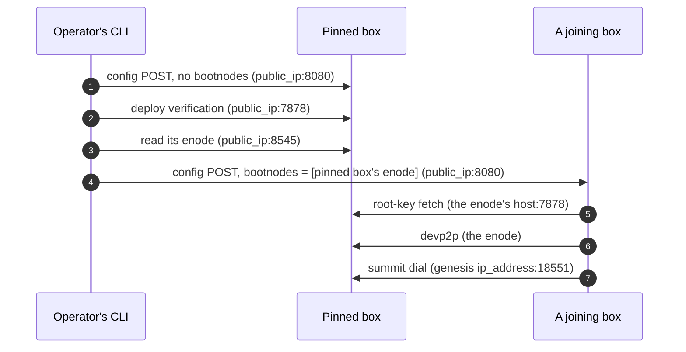

# Networking: Planes, Names and Discovery <!-- omit in toc -->

How a Seismic node finds the others, and how an operator finds the nodes.
Which ports a node exposes, and to whom, is in
[node.md](node.md#what-the-outside-can-reach).

The wire formats are normative elsewhere: the config POST's `[network]` and
`[node]` sections in
[tdx-init-config](https://github.com/SeismicSystems/enclave/blob/seismic/crates/tdx-init-config/src/lib.rs),
the summit genesis in [summit](https://github.com/SeismicSystems/summit), and the
node descriptor in
[`descriptor.rs`](../../tee/cli/common/src/descriptor.rs).

- [Summary](#summary)
- [Who reaches a node](#who-reaches-a-node)
  - [Consensus](#consensus)
  - [Transaction gossip](#transaction-gossip)
  - [Enclave peer RPC](#enclave-peer-rpc)
  - [Clients and the operator](#clients-and-the-operator)
- [Four kinds of name](#four-kinds-of-name)
- [Addresses](#addresses)
  - [Where each address comes from](#where-each-address-comes-from)
  - [DNS](#dns)
  - [What is verified about an address](#what-is-verified-about-an-address)
- [Bootstrap, phase by phase](#bootstrap-phase-by-phase)
  - [Founding](#founding)
  - [After founding](#after-founding)
- [Design rationale](#design-rationale)

## Summary

- **Three planes, each with its own identity, discovery and trust posture:**
  consensus, transaction gossip, and the enclave peer RPC that carries the
  root-key handshake. A compromise or eclipse of one never cascades into
  another.
- **A node carries several names.** Its name in the operator's node table,
  summit's Ed25519 node key on consensus, and reth's enode id on gossip all
  identify the same box, and none is derived from another.
- **Addresses carry availability, never trust.** Consensus authenticates by
  key, the root-key handshake attests both ends on every exchange, and devp2p
  carries only ciphertext. A wrong address costs a connection, not a secret.
- **The operator's CLI is the exception.** It appraises whatever answers at an
  IP, then hands another node an enode at that IP as a bootnode. That is the
  one place an address must be the one appraised. The config POST is guarded
  by the firewall, not by an appraisal.
- **Bindings are made late.** The bootnodes are found on each `configure` run,
  and the config, the advertised address included, is POSTed on every boot.
  What is bound early — the node table and the IPs in the summit genesis —
  goes stale when a box moves ([After founding](#after-founding)).
- **The node does not know its own address.** Its cloud NIC holds a private
  IP, so the operator tells it its public one in every config POST.

## Who reaches a node

Other nodes reach a node over three planes, each with its own identity key, its
own discovery, and its own trust posture. Clients and the operator reach it
too, [neither as a peer](#clients-and-the-operator).

| Plane | Port | Protocol | Node identity | How a node learns its peers' addresses | Membership |
| --- | --- | --- | --- | --- | --- |
| Consensus | `:18551` | commonware-p2p | summit's Ed25519 node key | the summit genesis's `ip_address` per validator, then each validator's own signed address, gossiped | closed: the peer set *is* the validator set |
| Transaction gossip | `:30303` TCP+UDP | devp2p: RLPx + discv5 | reth's enode id (secp256k1) | `[network].bootnodes` as discv5 bootnodes and RLPx trusted peers, then the discv5 DHT | open to anything carrying the `seismic` fork id |
| Enclave peer RPC | `:7878` | JSON-RPC over HTTP | none standing | `http://<host>:7878` for each bootnode's host | attested per exchange |

### Consensus

BLS12-381 signs consensus messages and Ed25519 is the transport identity.
Membership and the peer set are the same thing: commonware-p2p authenticates by
pubkey, so only a member of a tracked validator set completes a handshake.

summit runs commonware-p2p's authenticated discovery. On every start, its
initial dial set is the summit genesis: each genesis validator's node key and
`ip_address`, plus its own. Each node then signs its own address — the `--ip`
that tdx-init renders from `[node].external_ip` — and gossips it, so peers learn
current addresses from the nodes themselves. A stale or wrong address can delay
a connection but never admit a stranger. A validator that joined after the
genesis dials the genesis validators first, like everyone else.

### Transaction gossip

The identity is reth's own `discovery-secret`, under LUKS, so the node's
`enode://` address is stable for its life. Discovery is discv5 only — discv4
and DNS discovery are off — keyed by the `seismic` ENR fork id, so Seismic nodes
match only each other. The bootnodes are operational data, delivered per boot in
the config POST and never part of the hashed manifest; one live bootnode is
enough for discv5 to flood the rest. reth advertises the address it is told
(`--nat extip`, from `[node].external_ip`).

One enode list feeds both of reth's devp2p flags, because the two do different
jobs with it. `--trusted-peers` is how a node reaches the cohort: direct RLPx
dials, retried, and exempt from reputation slashing. `--bootnodes` is how it
reaches everyone else — it seeds discv5, and the DHT floods the rest, including
joiners that no founding-era list could have named. Keeping both matters because
discv5 bootstrap is one-shot: reth resolves a bare `enode://` with a live UDP
round-trip at startup and never retries a lost one, so on the discovery path
alone a single dropped packet could cost a node its seat in the mesh until the
next reboot. Both flags are re-delivered every boot, since the conf dir is
tmpfs.

Open membership on this plane is safe by construction, in three independent
ways:

- **`GetNodeData` and `NodeData` are hard-rejected** as bad messages, because
  raw trie nodes would carry FlaggedStorage values straight past the RPC
  layer's private-slot redaction.
- **Sync never follows devp2p** — summit drives reth's forkchoice over the
  Engine API — so eclipsing this plane costs transaction liveness, never
  safety.
- **The payload is ciphertext**: a gossip peer learns timing and size, nothing
  else.

### Enclave peer RPC

There is no standing transport identity here. Each exchange carries its own
attestation and its own AEAD in the message body, so the channel is deliberately
plain HTTP. Peers are derived, not configured separately: `tdx-init` takes one
bootnode list, drops this node's own entry (the one whose host is its own
`external_ip`), and renders every consumer from what remains:

- **reth's `--bootnodes`** and **`--trusted-peers`**, both the peer enodes.
- **`http://<host>:7878` per peer** for the root-key fetch.

All of them name the same machines by construction, so skew between the lists is
unrepresentable, and a node that must fetch `root_key` but is POSTed with no
usable peer fails the POST rather than booting with no way to obtain it
([`peers.rs`](https://github.com/SeismicSystems/enclave/blob/seismic/bin/tdx-init/src/peers.rs)).
The peers are located by attachment point only, and identified by the
handshake's mutual attestation on each exchange, not by the address.

### Clients and the operator

Two more parties reach a node, neither of them a peer:

- **Clients of the public RPC** reach a node through a front outside the CVM,
  which terminates HTTPS and forwards to reth's RPC and WebSocket, summit's
  JSON-RPC and the attestation service, each on its own port
  ([the port table](node.md#what-the-outside-can-reach)). The front is deploy's
  ([SEI-992](https://linear.app/seismic-systems/issue/SEI-992)). Its
  certificate authenticates the front's name, not the node: the operator
  controls that name's DNS ([DNS](#dns)) and the front, which reads
  non-shielded RPC in plaintext. It protects against third parties on the
  path. Everything a client relies on beyond that is end to end — transaction
  signatures, signed reads, encryption to `tx_io_pk`.
- **The operator's CLI** reaches a node by the node table's `public_ip`: the
  config POST on `:8080` and the founding harvest on `:7879`, both reachable
  only from the operator's address range, and deploy verification on the public
  `:7878`. It reads a node's enode, and in the launch assertions its block 0,
  from reth's RPC at `http://<public_ip>:8545`, never through the front.

## Four kinds of name

An IP address says where a node is attached to the network, not which node it
is: a box that moves keeps its keys and gets a new address. Saltzer's
[RFC 1498](https://www.rfc-editor.org/rfc/rfc1498) makes this precise with four
objects a network has to name: a **service** (what a client wants), a **node**
(the machine that provides it), a **network attachment point** (where that node
is on the network), and a **path** (how traffic gets from one attachment point
to another). Each needs a name, and each is bound to the next by someone, at
some time.

| Object | In Seismic | Its names |
| --- | --- | --- |
| Service | The network itself; its public RPC; `root_key`; consensus participation; transaction gossip | `network_id` names the network. Its public RPC is named by the front's hostname, which deploy chooses. |
| Node | A TDX box running the measured image | The node table's `<operator>-<key>`, which is also its Azure VM and DNS label, and its resource group unless the stack sets `cohort_resource_group`; summit's Ed25519 node key; reth's enode id (secp256k1). Nothing standing on `:7878`: each exchange attests itself. |
| Attachment point | The box's public IP, one port per plane | `<public_ip>:<port>` |
| Path | Internet routing, and Azure's NAT from the public IP to the NIC's private one | Not named by Seismic |

And the bindings between them:

- **Service → node.**
  - **`root_key`:** any node that holds it — a *key holder*, which answers on
    `:7878`. The CLI finds them by probing the node table.
  - **Consensus:** the validator set, in summit's consensus state.
  - **Public RPC:** DNS picks the front, and the front's path map picks the
    node and port.
- **Node → attachment point.** Bound in several places, listed in
  [Where each address comes from](#where-each-address-comes-from).
- **Attachment point → path.** The internet's, not Seismic's.

Two consequences run through the rest of this doc:

- **The peer planes separate a node's identifier from its locator, but store
  the mapping between them.** Consensus authenticates a key and the root-key
  fetch an attestation, and both only dial an IP. What joins the two is not a
  lookup but a stored pair: an enode is `<node id>@<ip>:<port>`, a summit
  genesis validator entry is a node key next to an `ip_address`, a node-table
  entry is a name next to a `public_ip`. Each goes stale when the box moves.
  Reading the pair late keeps it fresh; reading it from a stored copy does
  not. The public hostname makes no such split: it
  is both the service's name and, through DNS, its locator.
- **The node names are not bound to each other uniformly.**
  - **summit's keys:** bound to the TEE at founding, by the harvest's quote
    over them, and pinned through the summit genesis.
  - **reth's enode id:** bound to nothing attested.
  - **The node-table name:** the operator's own assertion.

## Addresses

Every address a node uses binds a node to an attachment point. Each binding is
written by someone, at some time, and checked by someone or by no one.

### Where each address comes from

| Binding | Written by | When | Read by, for |
| --- | --- | --- | --- |
| Node name → `{public_ip, fqdn}` | The provisioner: deploy's Pulumi program outputs the map, `seismic-tee ctx set-nodes` stores it. Or the operator, by hand, as a descriptor file. | Provisioning | The CLI, for every call it makes to a node |
| FQDN → public IP | The DNS A record (see [DNS](#dns)) | Provisioning | Nothing in the image, and none of the CLI's calls |
| `[node].external_ip` | The CLI, from the node table's `public_ip` | Every config POST, so every boot | tdx-init, which renders reth's `--nat extip` and summit's `--ip` |
| `[network].bootnodes` | The CLI. Founding: the genesis node's enode. Later: the enodes of the node table's key holders that pass their appraisal, or `--bootnode`. | Every config POST | tdx-init, which renders reth's `--bootnodes` and `--trusted-peers` and the `root_key` fetch peers |
| Summit genesis `ip_address` | `network assemble`, from the node table's `public_ip` for each founding validator | Assembly | summit, as its initial dial set |
| The same, delivered | `node configure` founding the network splices in the node table's current IPs; joining a live one, it sends the file `assemble` wrote as it is | Every config POST | summit |
| A validator's live address | The node itself, signed with its node key | summit's start, then gossip | Every summit peer |
| A gossip peer's address | discv5 | Runtime | reth |

The manifest pins none of these. `network_id` commits to the summit genesis's
consensus content, which excludes `ip_address`
([what summit's digest covers](network-manifest.md#what-summitgenesis_config_digest-covers)),
so an address can change without changing the network.

### DNS

- **What the FQDN is:** a per-node name at the node's public IP, which the
  CLI shows beside it. The node is never told it: the config POST carries no
  name, and the image serves no TLS.
- **What it is not for:** consensus, devp2p, the `root_key` fetch, the
  operator ports and the CLI's reth reads all use IP addresses. The public
  RPC's name is the front's
  ([clients and the operator](#clients-and-the-operator)).
- **How deploy's Pulumi program does it**
  ([`__main__.py`](https://github.com/SeismicSystems/deploy/blob/main/tee/pulumi/seismic_node/__main__.py)):
  - It needs an existing Azure DNS zone, named by the stack's `dns_zone_name`
    and `dns_zone_resource_group`.
  - It writes one A record per node, `<operator>-<key>.<zone>`, TTL 300, at the
    node's public IP.
  - The FQDN is derived from the node's name and the zone. It cannot be set per
    node.
- **Bringing your own DNS name:**
  - **A zone of your own, in Azure DNS:** supported. Set `dns_zone_name` and
    `dns_zone_resource_group` to it.
  - **A zone hosted elsewhere, or a name of your choosing per node:** not
    supported by the program. The node descriptor is the seam for it: an
    operator who provisions and names boxes their own way writes `{public_ip,
    fqdn}` per node by hand, and every CLI command reads that file the same way.

### What is verified about an address

- **summit:** nothing about the address. The handshake authenticates the node
  key against the validator set.
- **The root-key handshake:** nothing about the address. Both ends attest on
  every exchange
  ([the handshake](key-custody.md#the-root-key-handshake)).
- **devp2p:** nothing. Its payloads are ciphertext and sync never follows it.
- **The operator's CLI** binds its decisions to an attachment point:
  - **Deploy verification** appraises whatever answers at `public_ip:7878`: a
    TEE on an accepted image holding this manifest. It says nothing about which
    node keys that box holds.
  - **Handing out an enode** reads it from reth at `public_ip:8545`, the
    address that was appraised, and compares its host with that `public_ip`. tdx-init fetches `root_key` from
    that host, so a match means the joiner reaches the box that was appraised.
    - **Joining a live network:** a key holder whose enode is elsewhere is not
      handed out.
    - **Founding:** a mismatch only warns, and the pinned box's enode is
      handed out anyway.
  - **The config POST** goes to `public_ip:8080`, and the node takes the first
    POST of each boot. The firewall's operator address range is what keeps a
    stranger from POSTing first
    ([founding-window security](network-founding.md#founding-window-security)).
- **Not verified anywhere:**
  - That the node table's `public_ip` and `fqdn` are the operator's own boxes:
    that is the provisioner's output, or the operator's own file.
  - That `[node].external_ip` is the node's real address: the operator asserts
    it in the POST.

## Bootstrap, phase by phase

### Founding

The founding's steps — harvest, assemble, configure, launch checks — are in
[network-founding.md](network-founding.md#the-founding-flow); what matters here
is the configure step's addresses. `network assemble` has already written each
founding validator's `public_ip` into the summit genesis as its `ip_address`.
Every box boots waiting for its config, and the pinned box's reth enode does
not exist until its reth is up, so the joiners are configured in a second
stage:

The pinned box's enode reaches a joiner only after the pinned box passes its
appraisal, unless the founding runs with `--no-verify`. Its host is not checked
against the appraised `public_ip`: a mismatch only warns.

### After founding

- **A node of the operator's own cohort** — added later, or a founding box that
  rebooted and lost its tmpfs config — gets `seismic-tee node configure`, which
  skips the nodes that already took their config this boot. The CLI probes the
  node table, deploy-verifies every key holder, and hands out the enodes of
  those that pass and whose host is the IP it appraised. With none that
  passes, it sends nothing.
- **A node of another operator** has none of the network's key holders in its
  node table. It names a live peer with `--bootnode`, got from the network's
  operators or a live node's `seismic_nodeInfo`. Nothing publishes the network's
  key holders yet
  ([SEI-880](https://linear.app/seismic-systems/issue/SEI-880)).
- **A reboot** loses the tmpfs config, so the node is configured again as a
  joiner, with its address and bootnodes bound afresh.
- **A box whose IP changes:**
  - **Node table:** stale until the provisioner's map is imported again.
  - **DNS:** the provisioner rewrites the A record.
  - **Bootnodes:** fresh on every run, because the CLI reads enodes live.
  - **Advertised address:** fresh on the next config POST.
  - **Summit genesis `ip_address`:** spliced only when configure founds the
    network. Joining, it delivers the founding-era IPs, and summit dials the
    genesis IPs on every start, so a node's initial dial set can name
    addresses that have moved. Gossip corrects it once the node reaches any
    validator. Taking topology out of the genesis is
    [SEI-297](https://linear.app/seismic-systems/issue/SEI-297).

## Design rationale

- **Three planes rather than one multiplexed transport.** One transport with
  one identity would be less machinery, and would couple the failure domains:
  eclipsing it would cost consensus, gossip, and bootstrap together, and the
  identity key would inherit the strictest requirement of all three. Separate
  planes let each keep the posture it actually needs — a closed
  pubkey-authenticated set for consensus, open membership for gossip,
  per-message attestation for bootstrap.
- **Why the IPs are kept out of `network_id`.** An address is topology, not
  identity, and it changes for reasons unrelated to the network: a
  redeployment, a cloud's reassignment. Pinning it would make every move a
  different network ([network-manifest.md](network-manifest.md)).
- **Why the bootnodes are found on each run rather than stored.** A stored
  enode is a node→attachment-point binding read later. It goes stale when a box
  moves, and it says nothing about whether the box still passes its appraisal.
  Reading the enodes live, after appraising each key holder, keeps both
  current.
- **Why enodes name IPs rather than hostnames.** tdx-init and reth both accept a
  DNS host in an enode. The CLI hands out IP enodes because its appraisal is of
  an IP: with a hostname, DNS could resolve to a different box between the
  appraisal and the `root_key` fetch. Hostname enodes for other operators' joins
  are an open question in
  [SEI-880](https://linear.app/seismic-systems/issue/SEI-880).
- **Why the operator's address is told to the node.** On Azure, a NIC holds a
  private IP and the public one is NAT, so the box cannot read its own. A node
  that asked a public IP-echo service instead would take its own address from a
  third party. The operator already has the address, in the node table.
