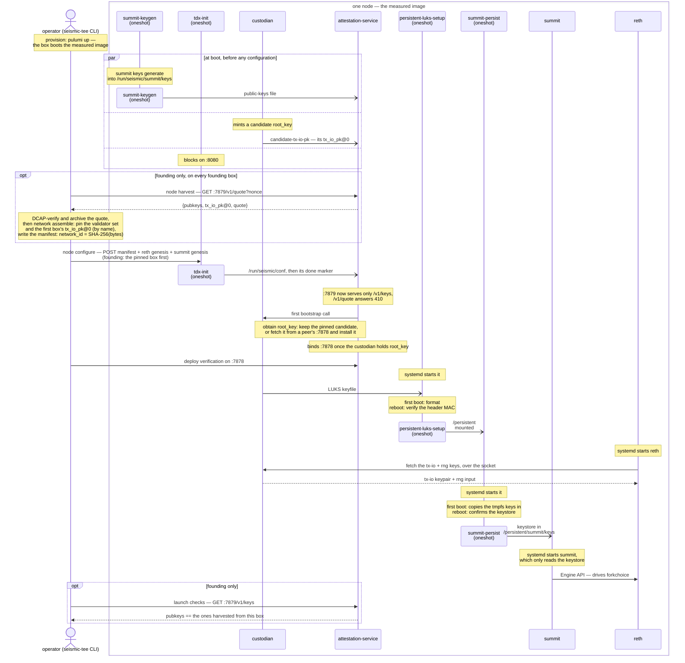

# The TEE Node <!-- omit in toc -->

**Status**: shipped. Where summit's database belongs is open, and stated
[where it bites](#persistent-the-luks-volume), with the current default named.

One Seismic TEE node, seen as a machine: what it assumes of the host it runs
on, how it boots, which processes run and how they reach each other, what it
exposes, and what it stores. The general node architecture — RPC, EVM,
storage, tries — is
[How Seismic Works](../gitbook/overview/how-seismic-works.md); this doc is
the TEE-specific shape around it. How the image is assembled — units, users,
groups, directories, each service's ports — is the
[seismic image module](https://github.com/SeismicSystems/seismic-images/blob/seismic/modules/seismic/readme.md),
and this doc links its tables rather than repeating them.

- [Summary](#summary)
- [The machine](#the-machine)
- [Node lifecycle: power-on to serving](#node-lifecycle-power-on-to-serving)
  - [First boot and reboot](#first-boot-and-reboot)
- [The processes](#the-processes)
  - [Unit groups](#unit-groups)
  - [One process opens the TPM](#one-process-opens-the-tpm)
- [IPC](#ipc)
- [What the outside can reach](#what-the-outside-can-reach)
- [Storage](#storage)
  - [`/persistent`: the LUKS volume](#persistent-the-luks-volume)
- [Design rationale](#design-rationale)

## Summary

- **One VM is one trust boundary.** One measurement, one IP, one `root_key`,
  one disk, and every process in it shares that fate.
- **Nothing starts until the operator POSTs the configuration.** `tdx-init` is
  the gate: it blocks, validates one config document, and fans it out to tmpfs.
  Every later unit finds its inputs on disk before it starts.
- **Each component is a group of systemd units.** Setup units run to
  completion, then the long-running service they prepare starts, and state
  crosses between them as files on tmpfs.
- **Two processes guard what matters.** The custodian holds `root_key`
  ([key custody](key-custody.md)), and the attestation service is the only
  process that can mint a quote.
- **Only `/persistent` survives a reboot**, and a key derived from `root_key`
  unlocks it, so every boot re-earns the node's state by obtaining `root_key`
  again.

## The machine

A node is one TDX confidential VM. What it assumes of the infrastructure it
runs on:

- **A confidential VM booted from a seismic-images release.** The release's UKI
  is the image identity, and on Azure it boots wrapped in a VHD; the release's
  `image.json` names the bytes
  ([published images](https://github.com/SeismicSystems/seismic-images/blob/seismic/README.md#published-images)).
  Azure is the platform today, and GCP is planned
  ([the host platform](trust-model.md#the-host-platform-and-what-it-is-trusted-for)).
- **A data disk for `/persistent`**, attached where the image looks for it
  (Azure LUN 10 by default). Its contents are opaque to the host: the first
  boot formats it under a key derived from `root_key`
  ([the volume](#persistent-the-luks-volume)).
- **A public IP, NATed to the NIC's private one.** The node cannot read its own
  public address, so the operator states it in every config POST
  ([networking](networking.md#where-each-address-comes-from)).
- **Firewall rules per port and source.** The peer ports are open to anyone,
  the RPC ports to the front, and the two operator ports only to the
  operator's address range
  ([what the outside can reach](#what-the-outside-can-reach)).
- **A public HTTPS front**, outside the CVM, which terminates TLS and forwards
  to the node's RPC ports.
- **A DNS name for the public IP** ([DNS](networking.md#dns)).

The release image has no SSH server and no swap. Nothing reaches the guest
except through the ports below, and nothing in guest RAM is ever paged to the
host's disk.

[deploy](https://github.com/SeismicSystems/deploy)'s Pulumi program
([`seismic_node`](https://github.com/SeismicSystems/deploy/blob/main/tee/pulumi/seismic_node/__main__.py))
is the one implementation of this contract. Per node, it imports the release's
VHD as the OS disk and creates the empty data disk, the public IP, the firewall
rules, the confidential VM and the DNS record, and it outputs the node
descriptor `seismic-tee` starts from. It only provisions: the config POST and
every attestation are the CLI's job. A provisioner that meets the list above
and writes a descriptor works the same way.

The host still owns the guest's disk, network, clock and lifecycle; what that
leaves it able to do is [the trust model's residuals](trust-model.md#residuals).

## Node lifecycle: power-on to serving

The UKI measures into the vTPM as it boots — what each register covers is the
[Azure guest-measurement review](https://github.com/SeismicSystems/seismic-images/blob/seismic/docs/azure-measurements.md)
— and systemd then starts the image's units.

Every unit past `tdx-init` waits on the config POST, directly or through a
dependency, except the three the founding harvest needs before it:
`summit-keygen`, the custodian, which mints a candidate `root_key`, and the
attestation service's harvest listener. One chain covers every boot of every
node. The founding-only steps are marked, and how the node obtains `root_key`
is one step here: the pinned box keeps its candidate once, and every other boot
fetches the key from a peer
([how a node obtains `root_key`](key-custody.md#how-a-node-obtains-root_key)).
The founder's side of founding is walked through in [network
founding](network-founding.md#the-founding-flow).

"(oneshot)" marks units that run to completion once per boot: each one's
lifeline ends where it exits, and a "systemd starts" note marks where it
begins. Solid arrows are messages over HTTP or a Unix socket, and open arrows
are files one unit leaves on tmpfs or disk for another:

- **The attestation service starts at boot, in two phases.** Before the POST it
  serves only the harvest on `:7879`, reading summit's public keys from the file
  `summit-keygen` wrote and the candidate's `tx_io_pk@0` from
  `candidate-tx-io-pk`. Once tdx-init marks its files written, it continues as
  a node: it loads the manifest, obtains `root_key`, and binds `:7878`.
  `/v1/quote` answers `410 Gone` from then on, and `/v1/keys` keeps serving for
  the launch checks.
- **An open `:7878` is the readiness signal.** The attestation service binds it
  only once the custodian holds `root_key`, so a peer or an operator never meets
  a listener whose key operations cannot succeed. Deploy tooling waits on it.
  The harvest port is a separate listener and does not change that contract.
- **The disk opens on the custodian's handoff.** `persistent-luks-setup` waits
  for the keyfile the custodian writes the moment it holds `root_key`
  ([the volume](#persistent-the-luks-volume)).
- **Founding needs three units before the POST.** Every founding validator's
  summit keys, and the `root_key` the manifest pins, must exist before
  `network_id` is minted. That is why `summit-keygen`, the custodian and the
  harvest listener run in parallel with `tdx-init` rather than after it
  ([network founding](network-founding.md)).

### First boot and reboot

A reboot runs the same chain as a first boot. Everything under `/run` is gone,
so the operator POSTs the configuration again (`seismic-tee node configure`),
and the steps differ only in what they find:

| Step | First boot | Reboot |
| --- | --- | --- |
| `root_key` | kept if this box is pinned at founding; otherwise fetched | always fetched: the fresh candidate matches no pin |
| `persistent-luks-setup` | formats the disk and wipes it to seed the integrity tags, an hour or more on a multi-TB disk | verifies the header MAC and opens the volume |
| `summit-persist` | copies the tmpfs keys into the keystore | confirms the keystore, and passes over this boot's fresh tmpfs keys |

## The processes

Four long-lived processes, and the oneshots that prepare them, all measured
into the image:

| Process | Its one job | Reachable from outside on | Holds |
| --- | --- | --- | --- |
| `tdx-init` (oneshot) | the config gate: validates one POST and writes one file per consumer | `:8080`, operator only | nothing secret |
| `custodian` | custody of `root_key` ([key custody](key-custody.md)) | nothing: a Unix socket only | `root_key`, its candidate |
| `attestation-service` | every quote, both halves of the root-key handshake, the [admission decision](chain-backed-admission.md), node status | `:7878`; `:7879`, operator only | no key material |
| `summit-keygen`, `summit-persist` (oneshots) | summit's keys from boot to its keystore ([network founding](network-founding.md#summits-keys-before-luks)) | nothing | summit's keys, in passing |
| `persistent-luks-setup` (oneshot) | opening `/persistent` | nothing | the LUKS keys, in passing |
| `reth` | execution: the EVM, Ethereum JSON-RPC, chain state, the gossip plane | `:8545`, `:8546`, `:9001`, `:30303` | the tx-io keypair, the RNG input, its devp2p key |
| `summit` | consensus: BFT voting, checkpoints, reth's forkchoice | `:3030`, `:9002`, `:18551` | its BLS and Ed25519 keys |

Each runs as its own system user. Users, groups, unit ordering and every
service's flags are in the
[seismic image module](https://github.com/SeismicSystems/seismic-images/blob/seismic/modules/seismic/readme.md#services).

### Unit groups

Each component is a group of systemd units: setup units that run to
completion, then the long-running service they prepare. systemd owns ordering,
restarts, users and sandboxing, and each process does one job.

- **A setup step is its own `Type=oneshot` unit**, not an `ExecStartPre=` of
  the service. With `RemainAfterExit=yes` it stays active after it exits, so
  it runs once per boot, where `ExecStartPre=` re-runs at every restart of the
  service. It also gets its own sandbox, so a step that writes the service's
  inputs doesn't hand the service the same write access: the service can get
  them through `ReadOnlyPaths=`, or not see them at all through
  `InaccessiblePaths=`.
- **State crosses between a component's units through a file in `/run`**,
  which is tmpfs ([IPC](#ipc)). No process is kept alive only to carry state.
- **A group restarts together.** Its units are `PartOf=` one target, so
  restarting the target re-runs its setup units, and every setup unit must be
  safe to run again. systemd passes the restart down only to units that are
  active, which is the other reason setup units are `RemainAfterExit=yes`.

Summit's group is spelled out in
[network founding](network-founding.md#summits-keys-before-luks): two setup
units carry its keys from boot to the keystore, and `summit.service` only
reads them.

The custodian and the attestation service are the key-plane group, tied by
`Requires=` rather than a target. `root_key` lives only in the custodian's
memory, so a custodian restart loses it, and the only thing that fetches it
back is the attestation service's startup
([how a node obtains `root_key`](key-custody.md#how-a-node-obtains-root_key)).

- **A custodian restart restarts the attestation service**, whether systemd
  restarts the custodian after a crash or an operator does. The attestation
  service comes back as a joiner and fetches the same `root_key` from a key
  holder.
- **Until then, the node fails closed.** `:7878` goes down with the old
  process and binds again only once the custodian holds `root_key`. A key epoch
  that activates in the meantime reaches reth only once the fetch completes;
  reth keeps retrying.
- **Nothing outside the group depends on its units.** `persistent-luks-setup`
  waits on the keyfile and reth on the socket, so a restart stays inside the
  group. That matters because `persistent-luks-setup` cannot run twice in one
  boot. The volume stays open, and the keys reth holds stay valid, because
  `root_key` comes back the same.
- **Two cases have no key to come back to.** Before founding, the restarted
  custodian mints a fresh candidate, the pin matches no box, and the founding
  is redone. With no live key holder, as on a single-node network, the fetch
  has no responder and the network is lost
  ([accepted risks](trust-model.md#accepted-risks)).

The unit edges, and what each restart reaches, are in
[`custodian.service`](https://github.com/SeismicSystems/seismic-images/blob/seismic/modules/seismic/mkosi.extra/etc/systemd/system/custodian.service).

The same rule says which secrets need a process. **A secret that is only ever
handed over needs a file with the right owner; a secret that is never handed
over needs a process.** Summit's keys and the LUKS keys are handed over, so a
tmpfs file that only the two sides of the handoff can read carries each.
`root_key` never leaves the custodian, which mediates every use of it.

### One process opens the TPM

The attestation service is the only process outside root that can mint a
quote, and it builds every `report_data` itself, from typed fields under a
domain tag. No caller ever supplies raw `report_data`, so no other process can
turn the TPM into a signing oracle. The `tpm` group has one member,
`attestation`.

The rule protects `root_key`. A process that can quote any `report_data` can
build a root-key request for an ephemeral key of its own, quote it, and have
any peer's responder wrap `root_key` to it. Every process that can open the
TPM is therefore in `root_key`'s trusted base, and the image keeps that set
to one ([design rationale](#design-rationale)).

## IPC

Every edge between two processes on the node, what it carries, and what keeps
other processes off it:

| From → to | Channel | Carries | Guarded by |
| --- | --- | --- | --- |
| reth, the attestation service → the custodian | Unix socket, length-prefixed CBOR | one key operation per request | the `custodian-ipc` group, then a per-user grant per method ([the socket](key-custody.md#two-layers-gate-the-socket)) |
| summit → reth | Engine API, Unix socket | forkchoice and payloads | the `engine-api` group |
| the attestation service → reth | JSON-RPC, loopback TCP `:8545` | the chain reads behind each admission decision | nothing: a TCP port has no owner (below) |
| tdx-init → every service | files in `/run/seismic/conf` | the manifest, both genesis files, per-service env | the `conf` group |
| the custodian → `persistent-luks-setup` | a keyfile, shredded after use | the LUKS volume key and header MAC key | file mode: the custodian user and root |
| the custodian → the attestation service, tdx-init | `candidate-tx-io-pk` | the candidate's `tx_io_pk@0` | the `custodian-ipc` group |
| `summit-keygen` → `summit-persist` | `/run/seismic/summit/keys` | summit's keypairs | the summit user only |
| summit's setup units → the attestation service | `public-keys.json` | summit's public keys | write access for summit's units only |
| `persistent-luks-setup` → the attestation service | `/run/seismic/status` | first-boot wipe progress | write access for root only |

Paths, owners and modes are the image module's
[directory table](https://github.com/SeismicSystems/seismic-images/blob/seismic/modules/seismic/readme.md#directories).

**One edge has no owner.** The attestation service reads the chain through
reth's RPC on loopback TCP. While reth is down, any process in the guest can
bind `127.0.0.1:8545` and answer every check of the admission decision, the
registry read included. The Engine API and the custodian use Unix sockets
instead, which carry an owner and file modes. Closing this is
[SEI-626](https://linear.app/seismic-systems/issue/SEI-626).

## What the outside can reach

No process in the guest terminates TLS. Each service answers on its own port,
in plain HTTP, and a front outside the CVM terminates public HTTPS and forwards
to them ([why no terminator in the image](#design-rationale)). The front,
and which sources the node's cloud firewall admits on each port, are deploy's
([the port table](https://github.com/SeismicSystems/deploy/blob/main/tee/pulumi/seismic_node/__main__.py)).
Three ports are peer-facing, and two are restricted to the operator's own
address range. Until the front exists
([SEI-992](https://linear.app/seismic-systems/issue/SEI-992)), deploy opens
`:8545` to the operator's address range alone, for the CLI, and the other RPC
and metrics ports to no one.

| Port | Source | What answers |
| --- | --- | --- |
| `:8545`, `:8546` | the front, and the operator's CLI | reth's JSON-RPC and WebSocket |
| `:3030` | the front | summit's JSON-RPC |
| `:9001`, `:9002` | per deploy's firewall | reth's and summit's metrics |
| `:7878` | anyone | the attestation service directly: the root-key handshake, tx-io evidence, health, first-boot disk-provisioning progress, and admission-chain status |
| `:18551` | anyone | summit's consensus plane |
| `:30303` TCP+UDP | anyone | reth's devp2p plane |
| `:8080` | operator only | `tdx-init`'s config POST |
| `:7879` | operator only | the attestation service's founding harvest: summit's pubkeys, and a quote over them until the manifest arrives |

- **The peer-facing ports are open** because admission is decided at the
  application layer, not by an address list: commonware-p2p completes a
  handshake only with a validator-set pubkey, and the root-key handshake
  carries its own mutual attestation. An address allowlist would add nothing
  and would break validators that join later. Each port serves one of three
  planes, each with its own identity, discovery and trust posture
  ([networking](networking.md)).
- **The two operator ports are operator-only permanently**, because both come
  back on every boot: `/run` is tmpfs, so `tdx-init` waits for a fresh POST
  each time, and `summit-keygen` writes fresh keys that the harvest port quotes
  until the manifest arrives. Whoever reaches `:8080` first configures the box,
  which is why the founding window is a supervised operation
  ([founding-window security](network-founding.md#founding-window-security)).
- **The image decides which ports listen beyond loopback and what each
  serves.** reth's RPC, WebSocket and metrics and summit's JSON-RPC and
  metrics bind `0.0.0.0`; reth's Engine API over HTTP (`:8551`) and summit's
  admin RPC (`:3031`) bind loopback. reth's public namespace list is
  `eth,net,web3`, and its general IPC-RPC server is disabled, so `admin`,
  `debug`, and `txpool` have no path to the outside; the `seismic` namespace
  registers alongside `eth`.
- **TLS is not a boundary.** It ends at the front, which reads non-shielded
  RPC in plaintext. Shielded requests rest on `tx_io_pk`, and the attestation
  evidence a browser fetches through the front is verifiable on its own
  ([keys, not channels](key-custody.md#design-rationale)).

## Storage

Everything under `/run` is tmpfs, in guest RAM, which TDX encrypts against the
host just as it does process memory. A reboot empties it: the configuration,
`root_key`, summit's boot-time keys, and every handoff file in [the IPC
table](#ipc). That is deliberate: every boot re-proves itself, with a fresh
config POST and a fresh, attested fetch of `root_key`.

Only `/persistent` survives a reboot.

### `/persistent`: the LUKS volume

One LUKS2 volume holds everything a node keeps across boots: reth's datadir,
summit's keystore and database. Its unlock key is
derived from `root_key`, so the volume is readable only by a guest that the
network has admitted. No human and no cloud operator ever holds the unlock
material, and there is no TPM seal to migrate or scrub.

**The key handoff.** The custodian writes the per-boot LUKS keyfile the moment
it holds `root_key`. `persistent-luks-setup` polls for it, uses the first 32
bytes as the unlock key and the second 32 as the header MAC key, and shreds it.

The volume is formatted `aes-xts-random` with a 512-bit key and dm-integrity
HMAC-SHA256. The random per-sector IVs are the point: they close the
snapshot-diff watermarking and equality-oracle attacks that deterministic XTS
allows. cryptsetup does not expose random-IV storage without the integrity
layer, so the HMAC comes bundled — and brings tamper-evidence with it.

**The header is MAC'd into the volume.** An attacker with disk write access can
flip the header's cipher to `cipher_null`; the keyslot KDF still validates
against the real unlock key, and dm-crypt then writes plaintext to disk
([CVE-2025-59054 / CVE-2025-58356](https://blog.trailofbits.com/2025/10/30/vulnerabilities-in-luks2-disk-encryption-for-confidential-vms/)).
So first boot computes `HMAC(header_mac_key, canonical_json({segments,
keyslots, digests}))` and stores it as a custom `seismic-header-mac` LUKS2
token. Every later boot copies the header to tmpfs, recomputes the MAC over the
same subset, compares, and opens with `--header` pointing at that verified copy
— which closes the window between checking the header and configuring dm-crypt.
A mismatch refuses the mount. Tokens are outside the MAC's scope, so storing
the token cannot invalidate it
([`persistent-luks-setup`](https://github.com/SeismicSystems/seismic-images/blob/seismic/modules/seismic/mkosi.extra/usr/bin/persistent-luks-setup)).

First boot also wipes the whole device to seed the integrity tags, which takes
an hour or more on a multi-TB disk. The script publishes byte progress to tmpfs
and the attestation service serves it as `getLuksProvisioningStatus`, because it
is the only HTTP-serving process alive for the whole wipe.

The volume is tamper-evident, not rollback-protected: a snapshot of the whole
volume restores cleanly ([the rollback family](trust-model.md#the-rollback-family)).

**Where summit's database belongs is open.** Today `/persistent/summit/db` rides
the volume and inherits its tamper-evidence. It has no at-rest secrecy
requirement — consensus state is broadcast data, and block payloads are
TxSeismic ciphertext either way — so it could sit outside. That
tamper-evidence, which LUKS provides and a plain filesystem does not, is the
one consideration; rollback protection is absent in both placements, so the
delta is targeted at-rest tampering only. Summit's *keys* stay inside the volume
in either outcome. Inside is the current default.

## Design rationale

Alternatives weighed and set aside, with the reasons that decided them. Each
names the section whose rule it settles.

**Setup units rather than setup inside the services**
([unit groups](#unit-groups)). A service can do its own setup: summit could
generate its keys and wait for the disk itself, or an `ExecStartPre=` on its
unit could. Both move ordering into code that re-runs at every restart and
shares the service's privileges, while a oneshot setup unit runs once per boot
under its own sandbox, and systemd already expresses the ordering. A
long-running process kept only to carry state between phases costs a
lifecycle, an IPC surface and a crash mode for something a tmpfs file does.

**The key-plane group restarts together, rather than the custodian never
restarting or the attestation service re-joining in-process**
([unit groups](#unit-groups)). With no `Restart=` on the custodian, a crash
would leave the node down until a reboot, although its peers still hold
`root_key`. An attestation service that notices the lost key and re-joins on
its own would move lifecycle logic into the application, which systemd
already expresses.

**One TPM user, building every binding itself, rather than a quote per
service** ([one process opens the TPM](#one-process-opens-the-tpm)). Letting
each service that needs a quote open the TPM is simpler wiring, but every one
of them could quote a root-key request of its own, so every one of them would
sit in `root_key`'s trusted base. A quote path under the summit user is the
sharpest case, since summit itself, network-facing for the node's whole life,
runs as that user and could open the TPM too. Letting a
caller pass raw `report_data` to the one TPM user would recreate the same
oracle one hop away. One owner is also the one place the vTPM can be
serialized: on Azure each quote takes it exclusively for seconds. If the
attestation service is ever split into a network-facing front end and a
verifier that holds the custodian grants
([SEI-627](https://linear.app/seismic-systems/issue/SEI-627)), the TPM goes
with the grants, behind the split; otherwise a compromised front end could
still obtain `root_key` from a peer.

**No TLS terminator in the image, rather than a proxy in the guest**
([what the outside can reach](#what-the-outside-can-reach)). Clients trust the
data and the key, not the channel, so nothing needs TLS to end in the CVM, and
an in-image certificate bound to no quote gives a client nothing to verify. A
proxy in the guest would put the most exposed parser on the node beside
`root_key`, where in-guest root can read it, and would need a new image to
change which routes are public. The options pass, and the condition for
bringing a terminator back, are in
[the public RPC trust record](decisions/2026-10-public-rpc-trust.md).

**A `root_key`-derived LUKS key rather than a TPM-sealed one**
([the volume](#persistent-the-luks-volume)). A TPM-sealed volume key unlocks for
whoever holds the platform, which is exactly the party the threat model excludes.
Deriving it from `root_key` means the disk is readable only by a guest the
network admitted, and it collapses two problems into one: whatever protects
`root_key` protects the volume. It also means a wrong `root_key` fails at the
header MAC rather than mounting a volume full of unreadable state.
