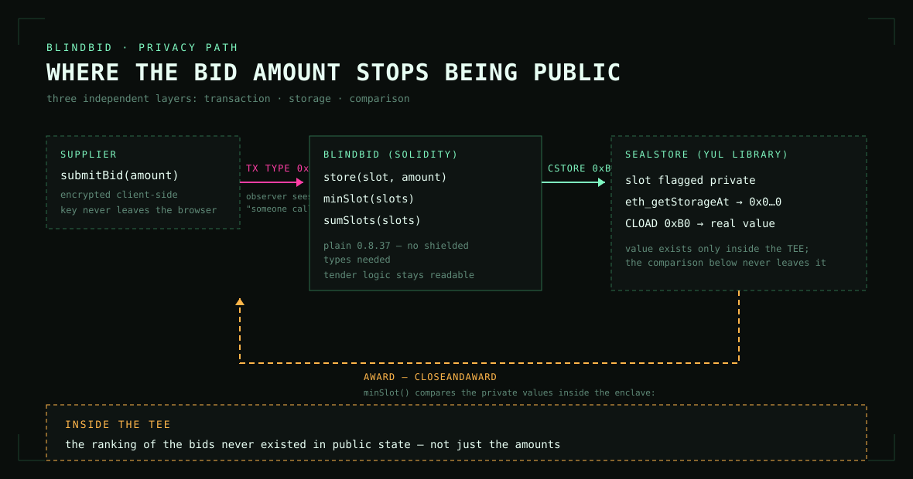

# BlindBid — a sealed tender on Seismic

A tender where **the bid amount never appears in public state and never appears in the transaction**.

The calldata is encrypted (transaction type `0x4A`), the price lands in a private slot (`CSTORE`), and the
winner is computed **inside the TEE** — only the winning slot leaves the enclave. Not just the amounts:
the *ranking* of the bids never existed publicly either.

- **Showcase repository (full source, scripts, front end):** <https://github.com/Juniorj87/blind-bid>
- **Live deployment:** `BlindBid` [`0xd9191d5f065a44778890de4e80c57fc2b1237ec4`](https://seismic-testnet.socialscan.io/address/0xd9191d5f065a44778890de4e80c57fc2b1237ec4),
  `SealStore` [`0x427b3bc3a4fae1862ca380ffba35b349e7f91e85`](https://seismic-testnet.socialscan.io/address/0x427b3bc3a4fae1862ca380ffba35b349e7f91e85)
  (Seismic testnet, chain 5124)
- **Test report:** [`TEST-REPORT.md`](TEST-REPORT.md) — 25 checks against the live deployment


## The three layers

| Layer | What an observer sees |
|---|---|
| **Transaction** | "someone called a function on `0xd919…7ec4`" — not which function, not the arguments (type `0x4A`) |
| **State** | `eth_getStorageAt` → `0x0000…0000` for every bid slot |
| **Comparison** | the winner only — the ordering was computed inside the enclave and never left it |



## What is in this folder

```
contracts/BlindBid.sol     # tender logic — plain Solidity 0.8.37
contracts/SealStore.yul    # private storage: CLOAD/CSTORE, minSlot, sumSlots
TEST-REPORT.md             # the generated report against the live deployment
docs/                      # screenshots and diagrams
```

`SealStore` is a **Yul** library: `Seismic` ships no Windows build of its compiler (`sforge`/`ssolc` are
linux/macOS only) and the shielded types (`suint256`, `sbool`) exist only in that compiler, so the private
slot primitives are injected through `verbatim` and the tender logic stays plain, readable Solidity. The
library is called with an ordinary `call`/`staticcall`, **not** `delegatecall` — `CLOAD` inside a
delegatecall does not work in the `eth_call`/static context the node uses to simulate.

## The demo on chain

| Lot | Subject | Envelopes | State |
|---|---|---|---|
| #01 | Supply of server hardware | 3 | AWARDED — winner bid 12.00 sUSDC of 50 / 12 / 90 |
| #02 | Confidential audit of a treasury | 4 | ACCEPTING BIDS — sealed price, the winning price is never published |
| #03 | Managed security monitoring | 2 | AWARDED — 45.00 sUSDC |
| #04 | Supply of network switches | 1 | CANCELLED (pilot run) |
| #05 | Supply of network switches | 2 | AWARDED — 63.00 sUSDC |


The buyer sheet is a **signed read**: on Seismic, `eth_call` does not apply `from`, so `msg.sender` is
recovered from a signature. The raw slots on the right of the screenshot are what every observer gets —
zeros.

## Wallets and gas

Testnet only, no value. The deployer (`0x424fF7f4A7CBB654E5168829C8535be3C0ef2e6c`) is a burner funded
from the official faucet (10 sUSDC per GitHub account per 24 h); the demo buyer and the two demo suppliers
are published in the showcase repository so anyone can reproduce the demo. A sealed bid is a type `0x4A`
transaction and costs ≈ 0.07 sUSDC, a plain transaction ≈ 0.003 sUSDC.

## Why this exists

Sealed-bid auctions exist on other chains — Arcium, Inco, Zama, Midnight, Story — but only as ★0–5 hobby
repos about NFTs, freelance work, agriculture or data marketplaces, and none of them on Seismic. Three
things are different here:

1. **The award is computed in the shielded domain** — the ordering of the bids never existed publicly.
2. **It is a tender, not an auction** — criteria, deadline, award notice, and an audit aggregate
   (`totalCommitted`) that reveals the sum without any single bid.
3. **The price can stay sealed after the award** (`sealedPrice`, lot #02) — in compliance-grade
   procurement it does not have to be published.

Seismic's testnet was built with local governments, and municipal procurement is sealed by law. The point
of the demo is not to farm transactions: it is to show that a real procurement workflow runs end to end on
Seismic privacy primitives, with the audit trail a regulator would ask for and without exposing the
commercial data of the bidders.

## Reproduce it

```bash
git clone https://github.com/Juniorj87/blind-bid.git
cd blind-bid && npm install
echo "MAIN_PK=0x..." > .env      # your own funded testnet key
npm run seed                    # deploy + demo data
npm test                        # 25 read-only checks against your deployment
npm run writer & npm run web    # the front end
```
